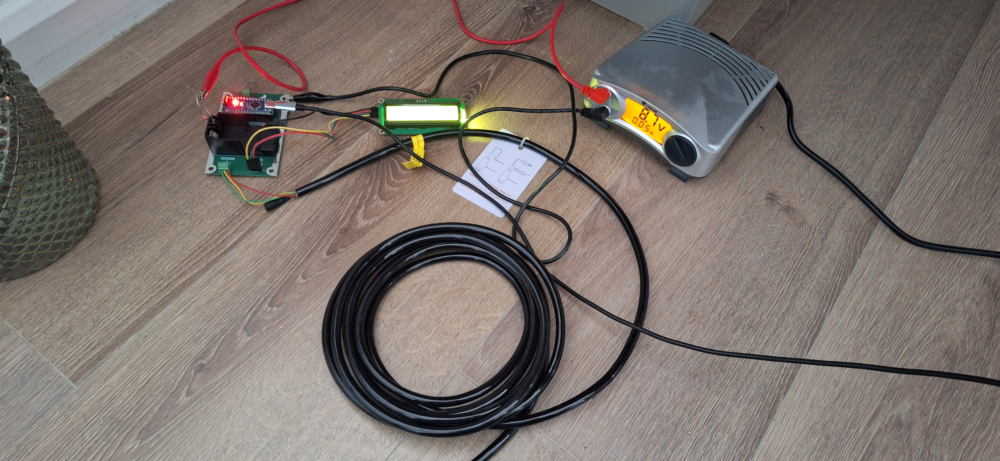
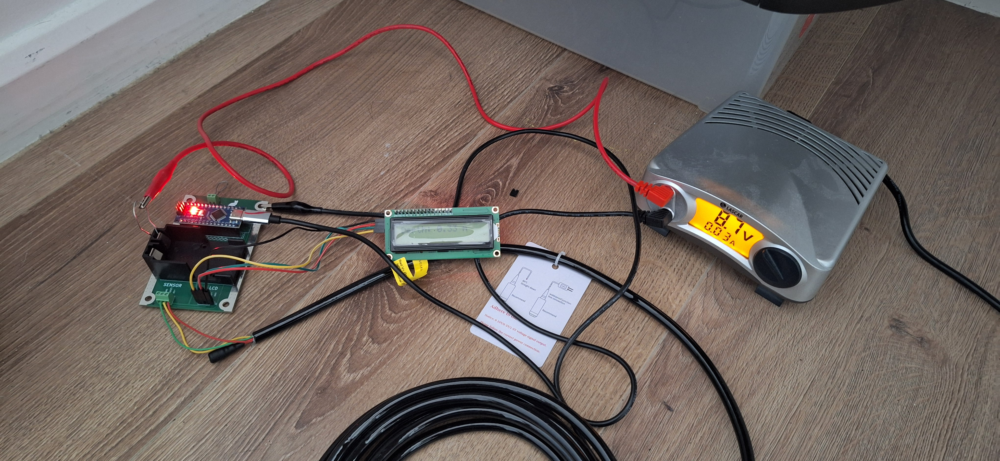
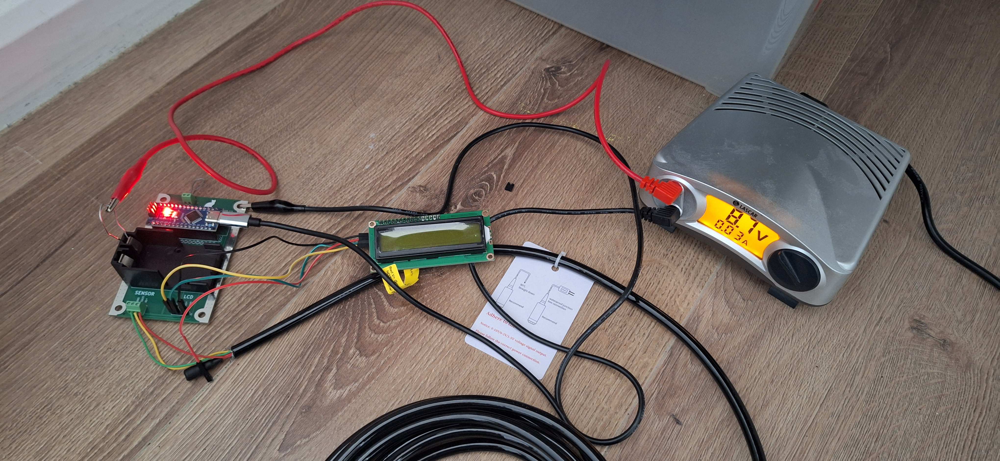
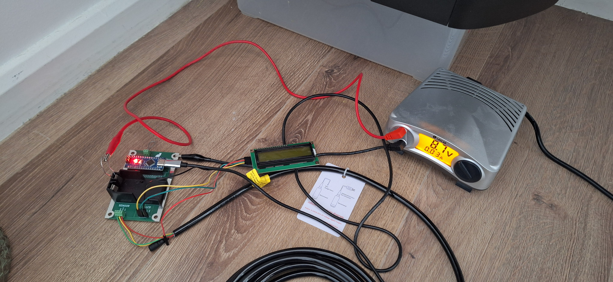
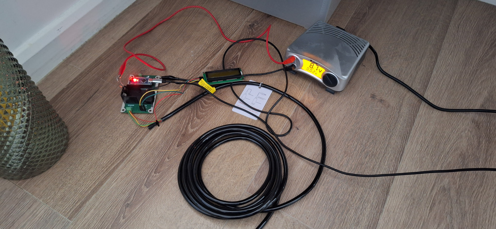
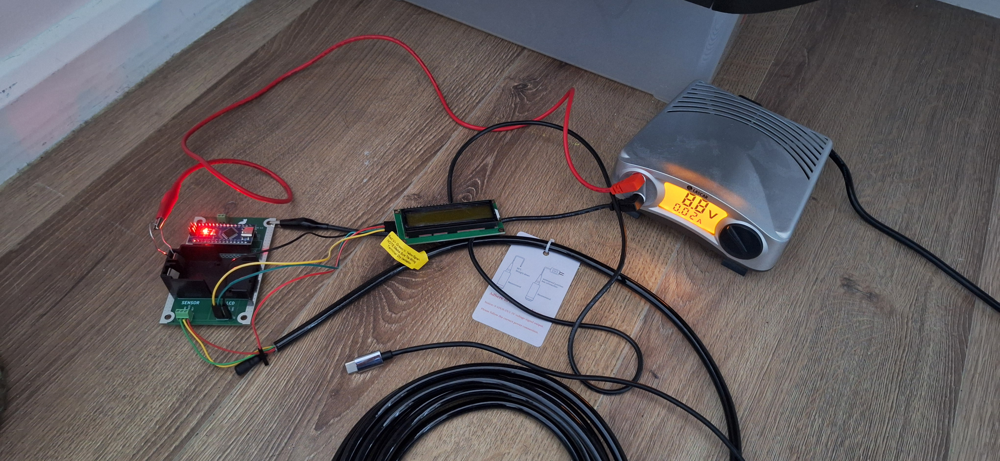

# Consumption

## Measurements

Consumption with all (consumption around 0.5 mA):

Remove backlight (consumption around 0.3 mA):

Remove LCD (consumption somewhere between 0.2 and 0.3 mA):

Turn off LED (consumption 0.2 mA)

Remove USB (consumption 0.2 mA)

## Summary

Total: around 0.5 mA.
  Backlight: around 0.2 mA.
  Arduino + sensor without extras: 0.2 mA.
